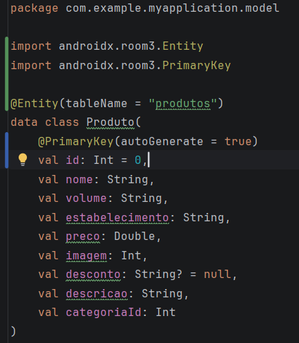
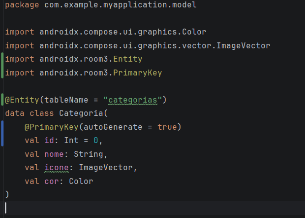
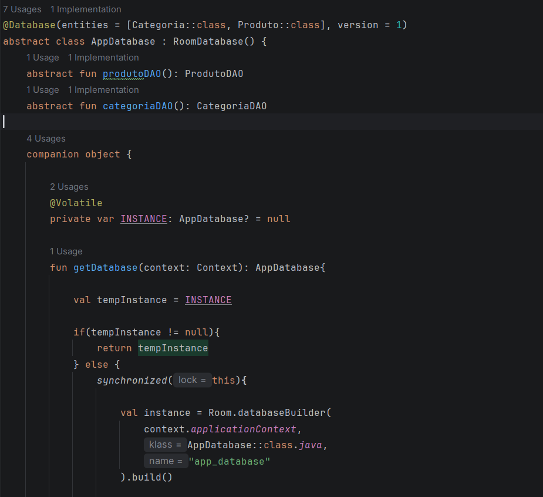
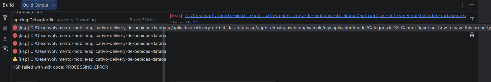

# Registro do processo de 

Nessa etapa, vamos juntar as features que já existem no código com o banco de dados, até então os objetos eram mantidos apenas em memória e desapareciam quando a aplicação era encerrada, agora o objetivo é manter no banco de dados.
A primeira coisa que fazemos é transformar as classes dos produtos e categorias em entidades para as tabelas do banco:

Em seguida criamos o AppDatabase, para retornar a conexão com o banco:

Decidimos por criar 

No entanto, quando rodamos a aplicação ela deu erro, aparentemente o Room só consegue gravar tipos simples, então quando tentamos gravar no banco imagens e cores ele falha:
