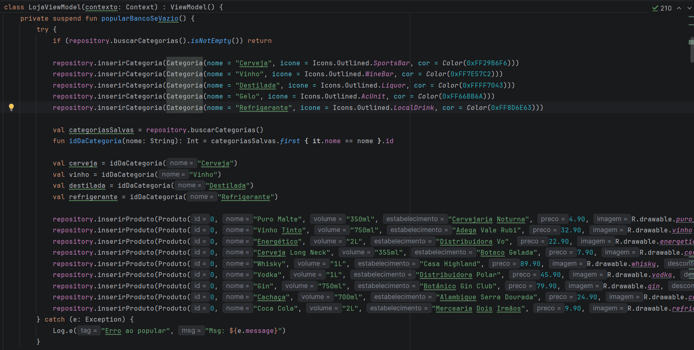
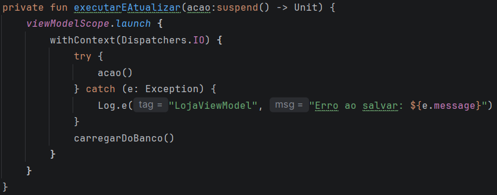
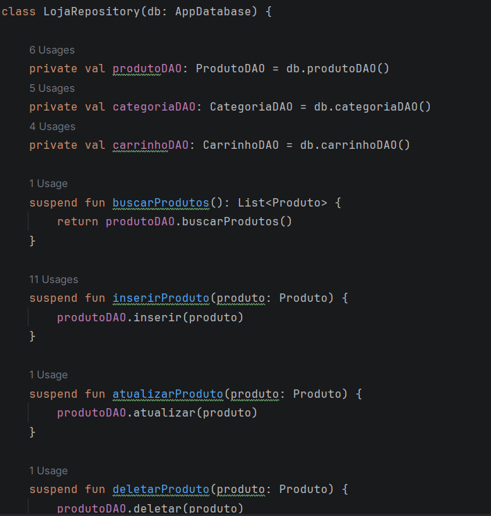
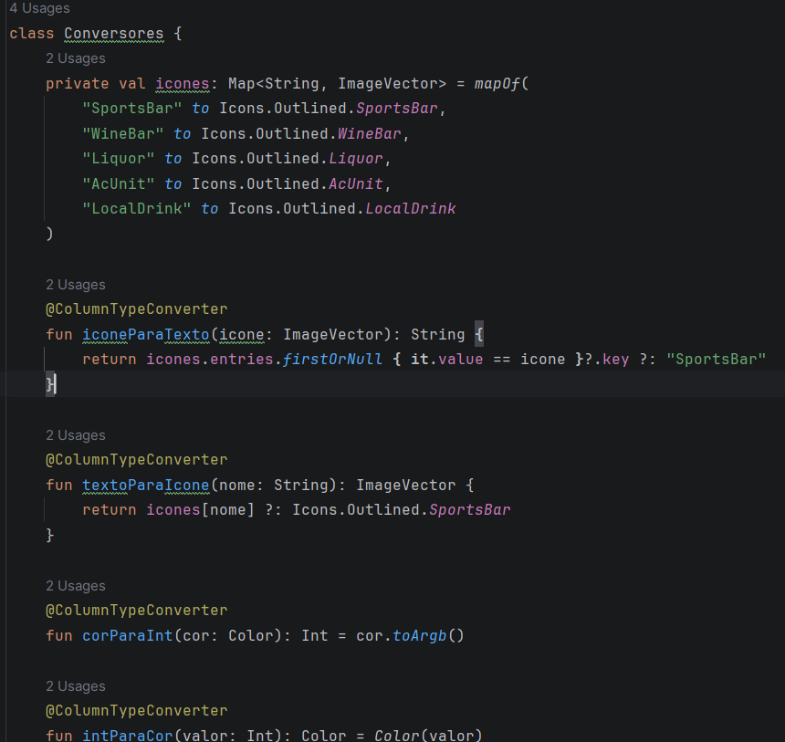
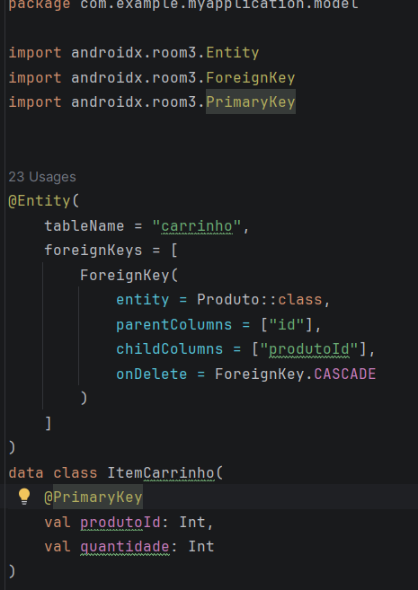
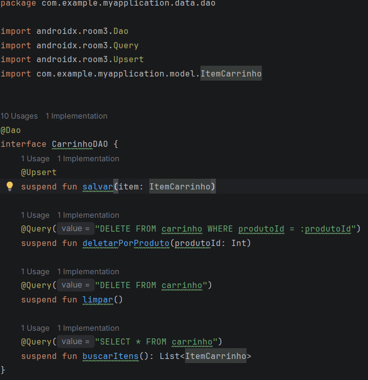

# Registro do processo da etapa 3 do trabalho (banco de dados)

Nessa etapa, vamos juntar as features que já existem no código com o banco de dados, até então os objetos eram mantidos apenas em memória e desapareciam quando a aplicação era encerrada, agora o objetivo é manter no banco de dados.
A primeira coisa que fazemos é transformar as classes dos produtos e categorias em entidades para as tabelas do banco:

Em seguida criamos o AppDatabase, para retornar a conexão com o banco:

Decidimos por manter uma arquitetura que funciona da seguinte maneira, as listas que antes guardavam os objetos das listas aogra funcionam como uma espécie de cache, quando iniciamos a aplicação ela povoa o banco com os dados pré criados, e os metódos lidam com a lista que existe em memória, e quando há mudança no banco diretamente existe uma função que atualiza o banco automaticamente com base nas listas, de modo que as listas funcionam como um espelho do próprio banco de dados.
Além disso, criamos um repository que concentra todas as operações diretemente nos Daos, assim a ViewModel só conhece o repositório e não chama os metódos dos Daos diretamente.

No entanto, quando rodamos a aplicação ela deu erro, aparentemente o Room só consegue gravar tipos simples, então quando tentamos gravar no banco imagens e cores ele falha:

Para contornar essa dificuldade criamos um arquivo de conversores que convertem esses atributos que o Room não consegue lidar bem para tipagens mais simples que funcionam:

Por fim, decidimos criar o carrinho de compras em memória junto com os produtos e categorias, de modo que quando saímos do app ele se mantém até que seja finalizada a compra, momento que ele é limpo:

Assim os produtos, categorias e carrinho de compras ficam salvos no banco de dados, e todas as alterações que são realizadas neles se mantém mesmo depois que fechamos o aplicativo, a seguir segue o vídeo de demonstração do aplicativo funcionando.

