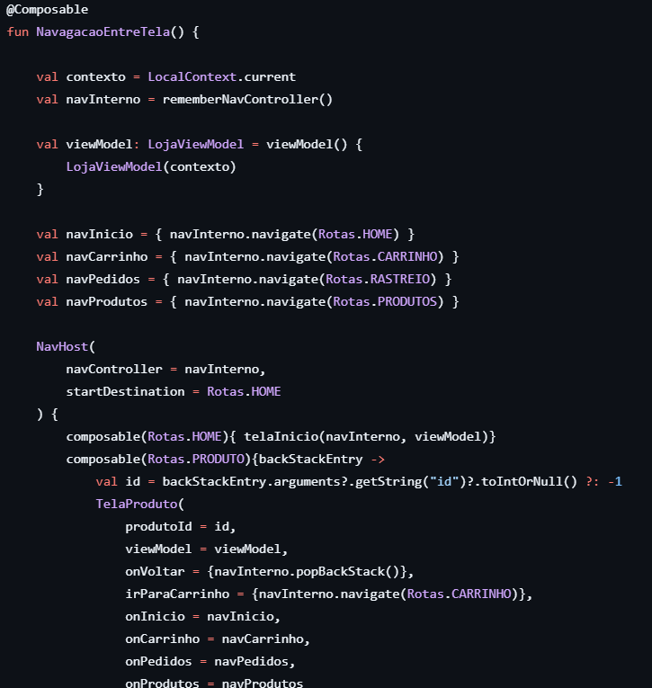
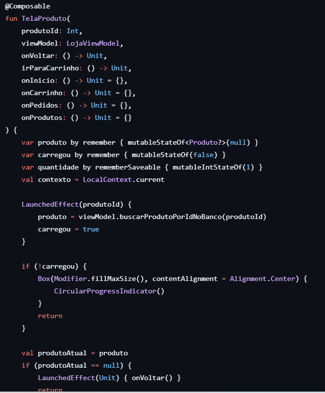
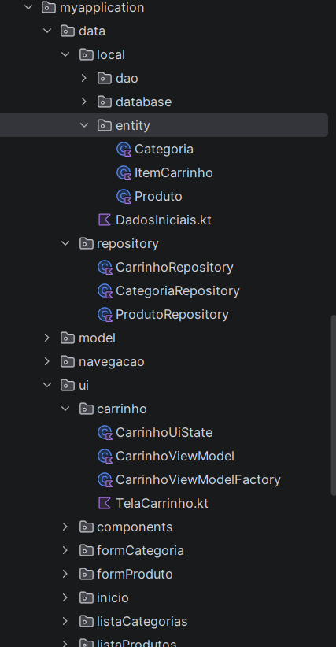
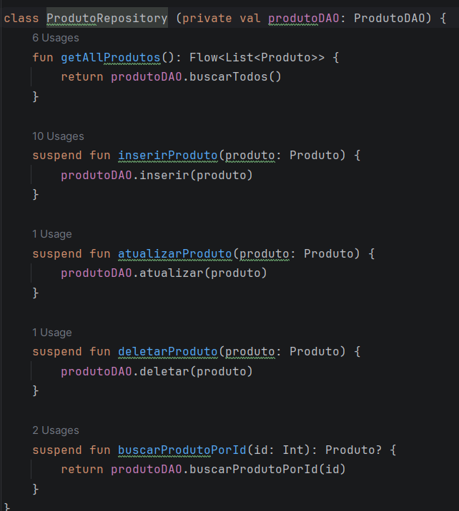
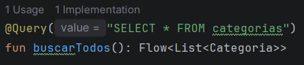
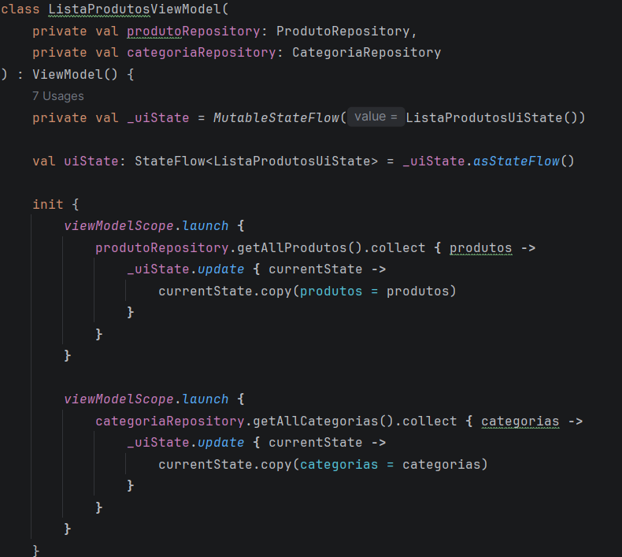
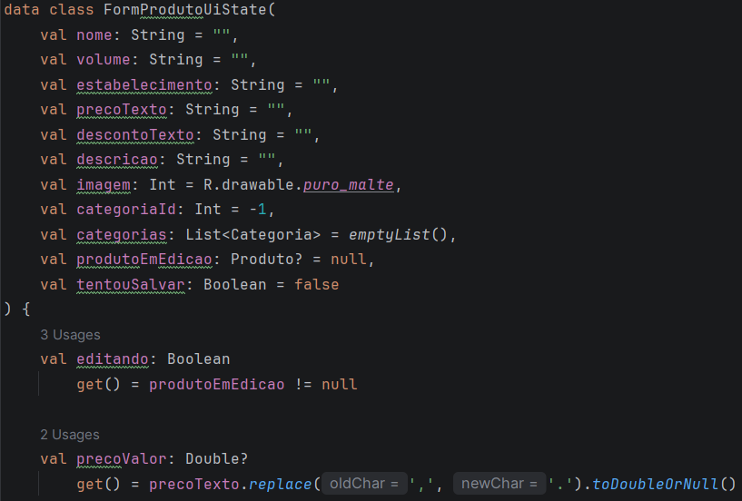
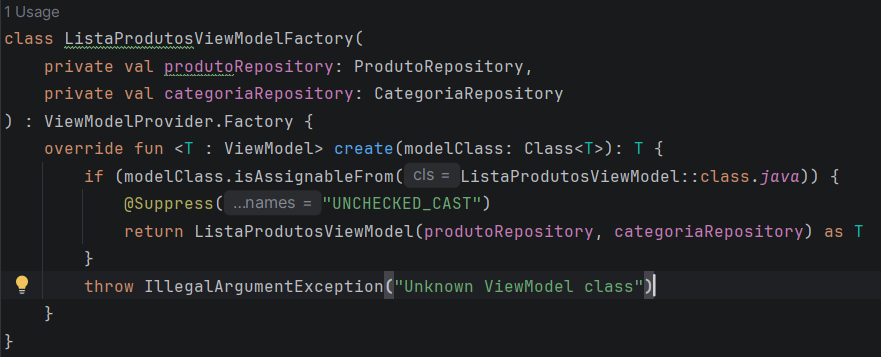

# Trabalho 4: registro do processo

Este é oTra balho 4 da A2, continuação direta do Trabalho 3. Não foi criada nenhuma tela, campo ou funcionalidade nova. O app faz o mesmo que fazia, mas agora está organizado em camadas: Model, Repository, ViewModel e View.

VÍDEO 1 - App funcionando após a refatoração: [colar link do vídeo]

---

## 1. Como estava o projeto no Trabalho 3 e o que mudou

### Como era (Trabalho 3)

- Um único LojaViewModel guardava tudo: produtos, categorias, carrinho, validação de formulários, cálculo de subtotal e total, e até a função que povoa o banco.
- Ele recebia o Context no construtor e criava sozinho o LojaRepository(AppDatabase.getDatabase(contexto)).
- Um único LojaRepository juntava as operações das três entidades.
- Os dados ficavam em mutableStateListOf dentro do ViewModel, funcionando como cache do banco. Depois de cada alteração, uma função recarregava as listas.
- O ViewModel usava Dispatchers.IO e withContext.
- As telas recebiam o LojaViewModel como parâmetro, criado uma vez só em AppNavigation, e guardavam estado local em várias variáveis remember.
- Todas as telas ficavam juntas em ui/screens/, e as entidades estavam em model/.

### Como ficou (Trabalho 4)

ViewModel: 9 ViewModels, um por tela que necessita.
Estado da tela: 9 UiState diferentes com data class com StateFlow.
Repository: 3 repositories, um para cada entidade do banco.
Atualizar a lista após mudança: recarrega automaticamente através do Room que emite o novo valor no Flow.
Criação do ViewModel: são criados diretamente nas telas utilzando os viewmodels factories.
Telas: cada tela obtém o seu ViewModel e utiliza o uiState para mudar as variáveis para construir as telas.
Entidades: Separamos do pacote antigo model e criamos um pacote novo chamado entity.

---

## 2. Por que o Repository existe

No Trabalho 3 já existia um LojaRepository, mas ele era um balaio único com as operações de todas as entidades, e o ViewModel ainda criava o banco a partir do contexto.

No Trabalho 4 o Repository passou a ser um por entidade, e cada um recebe só o DAO dele no construtor:

- O ViewModel não conhece mais Context, AppDatabase nem DAO. Só pede dados ao Repository.
- Se um dia os produtos vierem de uma API, muda só o ProdutoRepository. ViewModel e tela continuam iguais.
- Fica fácil testar um ViewModel passando um Repository falso.

---

## 4. DAO reativo com Flow

Em cada DAO, a função de buscar todos deixou de ser suspend e passou a retornar Flow:

Isso foi feito nos três DAOs (ProdutoDAO, CategoriaDAO, CarrinhoDAO).

O Room reemite a lista sozinho sempre que a tabela muda. Por isso a função carregarDoBanco() e o executarEAtualizar do Trabalho 3 foram removidos. Depois de inserir, atualizar ou deletar, a tela atualiza sem ninguém pedir.

VÍDEO 2 - Lista atualizando sozinha:

---

## 5. UiState e ViewModel de cada tela

Cada ViewModel segue o mesmo padrão pedido no enunciado: _uiState privado e uiState público. As telas coletam com collectAsStateWithLifecycle() e só chamam métodos do ViewModel. Dentro do ViewModel, as listas vêm do Repository por collect no init. Cada vez que o Room emite uma lista nova, ela entra no uiState com copy().

---

## 6. ViewModelFactory

O Android não sabe criar um ViewModel com parâmetros no construtor, então cada ViewModel ganhou sua Factory, que recebe os Repositories e os repassa:

## 8. Dificuldades da equipe

Nossa maior dificuldade foi decidir como ficaria a organização dos diretórios das telas, se criaríamos uma pasta para cada feature ou para cada tela. No fim, decidimos deixar uma pasta cada tela com seus respectivos arquivos utilizados, como a UiState, ViewModel e ViewModelFactory, apenas a tela de rastreio não tem esses arquivos pois não é necessário, visto que ela é uma tela estática que não tem métodos para mudar dinamicamente. 

---